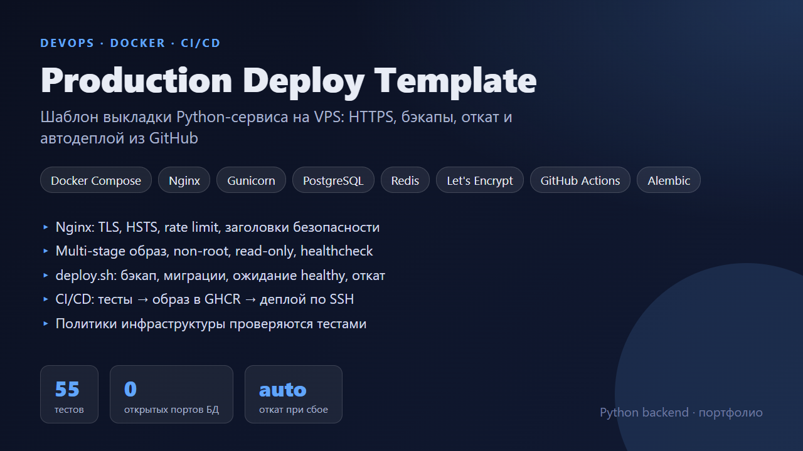
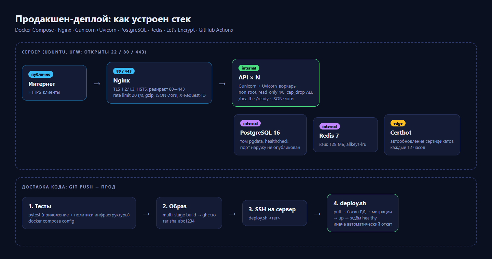
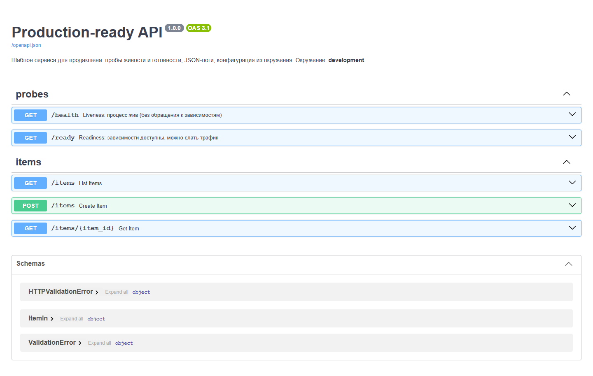
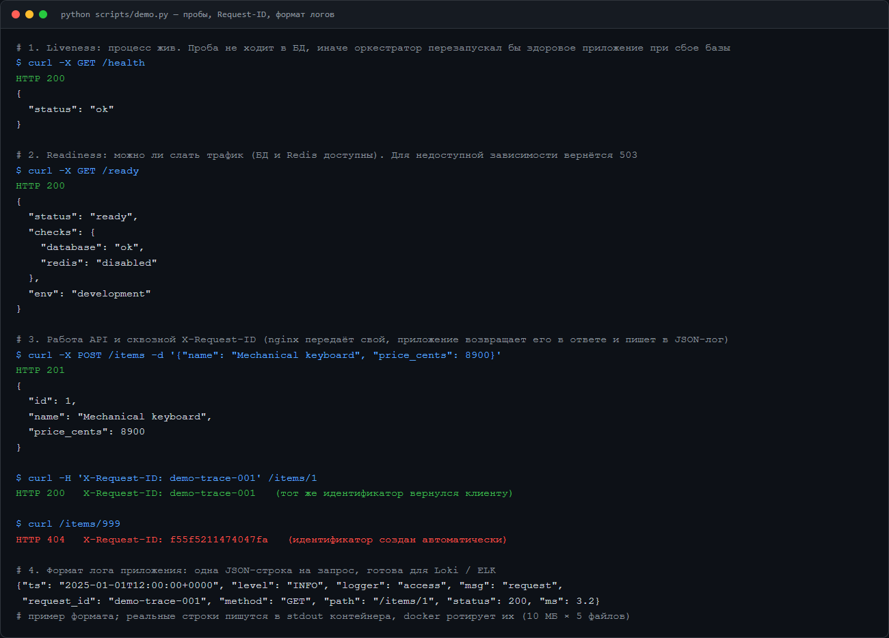
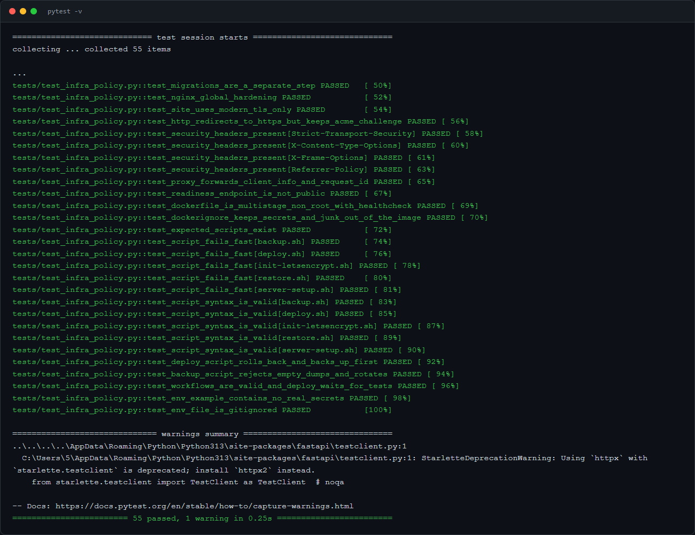

# Production Deploy Template

Шаблон, с которого начинается выкладка небольшого Python-сервиса на свой сервер (VPS): HTTPS, база с бэкапами, безопасные контейнеры, автодеплой из GitHub и откат, если новая версия не поднялась.





## Что внутри

| Часть | Что сделано |
|---|---|
| **Образ** (`Dockerfile`) | Multi-stage: зависимости собираются в отдельном слое, в итоговом образе нет компиляторов. Пользователь без прав root, `HEALTHCHECK`, запуск через Gunicorn с воркерами Uvicorn |
| **Стек** (`docker-compose.prod.yml`) | Nginx, API, PostgreSQL, Redis, Certbot. Наружу опубликованы только 80 и 443. БД и Redis видны только во внутренней сети. Лимиты ресурсов, ротация логов, `restart: unless-stopped` |
| **Контейнер API** | `read_only`, `cap_drop: ALL`, `no-new-privileges`, `stop_grace_period` длиннее `graceful_timeout` Gunicorn: запросы дорабатываются при перезапуске |
| **Nginx** | TLS 1.2 и 1.3, HSTS и заголовки безопасности, редирект на HTTPS, rate limit, JSON-логи, сквозной `X-Request-ID`, служебные ручки закрыты |
| **Пробы** | `/health` (процесс жив, не ходит в зависимости) и `/ready` (БД и Redis доступны, иначе `503`) |
| **Конфигурация** | Только переменные окружения. В `production` приложение не стартует с дефолтным или коротким `SECRET_KEY` |
| **Деплой** (`deploy/scripts/deploy.sh`) | pull образа, бэкап БД, миграции Alembic, запуск, ожидание `healthy`. Если версия не стала здоровой, автоматический откат на предыдущий тег |
| **Бэкапы** | `backup.sh` (pg_dump + gzip, отказ при пустом дампе, ротация), `restore.sh` с подтверждением |
| **Сервер** | `server-setup.sh`: отдельный пользователь, вход только по ключу, ufw, fail2ban, автообновления. `init-letsencrypt.sh`: выпуск первого сертификата |
| **CI/CD** | Тесты и проверка compose, затем сборка образа и публикация в GHCR, затем деплой по SSH |
| **Логи** | JSON, один `request_id` проходит через nginx и приложение |

## Инфраструктура проверяется тестами

`tests/test_infra_policy.py` фиксирует требования как код. Если кто-то откроет порт БД, поставит `:latest`, уберёт healthcheck или ослабит TLS, CI упадёт:

- наружу публикуются только порты nginx, а у образов сторонних сервисов закреплены версии;
- API-контейнер усилен (read-only, без capabilities), у БД есть healthcheck, а API ждёт её готовности;
- nginx: только TLS 1.2 и 1.3, HSTS, заголовки безопасности, закрытый `/ready`;
- Dockerfile: multi-stage, `USER` не root, `HEALTHCHECK`;
- скрипты: `set -euo pipefail`, корректный синтаксис (`bash -n`), порядок в `deploy.sh`: бэкап, миграции, запуск;
- `.env.example` без реальных секретов, `.env` в `.gitignore`.

## Запуск

Локально:

```bash
docker compose up --build        # http://localhost:8000/docs
pytest                           # без Docker: pip install -r requirements.txt
```

На сервере (кратко, подробности в комментариях скриптов):

```bash
# 1. чистый Ubuntu, от root
./deploy/scripts/server-setup.sh deploy "ssh-ed25519 AAAA..."
# 2. под пользователем deploy: клонировать репозиторий в /opt/myapp, cp .env.example .env, заполнить
./deploy/scripts/init-letsencrypt.sh        # сертификат (DNS домена уже указывает на сервер)
# 3. дальше деплой идёт из GitHub Actions (секреты SSH_HOST, SSH_USER, SSH_KEY, GHCR_TOKEN) или вручную:
./deploy/scripts/deploy.sh sha-abc1234
```

## Что проверено, а что нет

Проверено в этом репозитории: тесты приложения и инфраструктурные политики (55 тестов), синтаксис всех shell-скриптов, валидность обоих compose-файлов командой `docker compose config`.

Полный запуск стека на реальном сервере (`docker compose up`, выпуск сертификата, деплой по SSH) в рамках подготовки репозитория не выполнялся: перед использованием прогоните его на тестовом сервере.

Компромисс в `deploy.sh`: контейнер API пересоздаётся, так что возможна пауза в несколько секунд. Для нулевого простоя нужна схема blue/green с двумя наборами контейнеров.

## Скриншоты

| Swagger | Демо-сценарий | Тесты |
|---|---|---|
|  |  |  |
